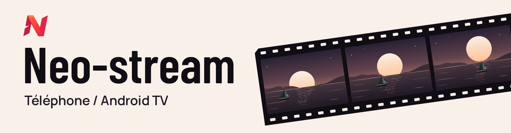
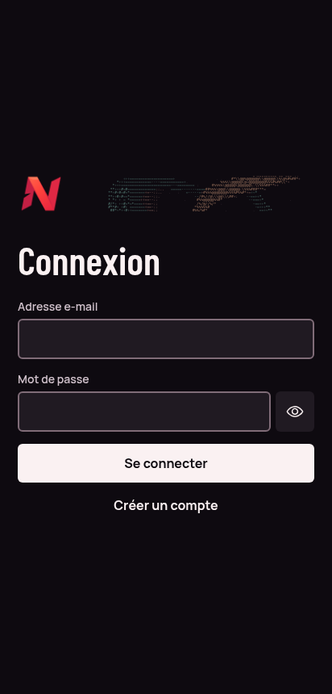
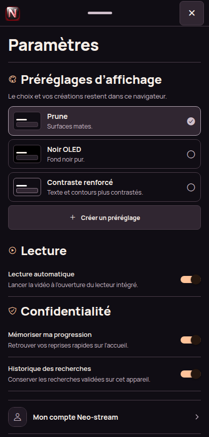
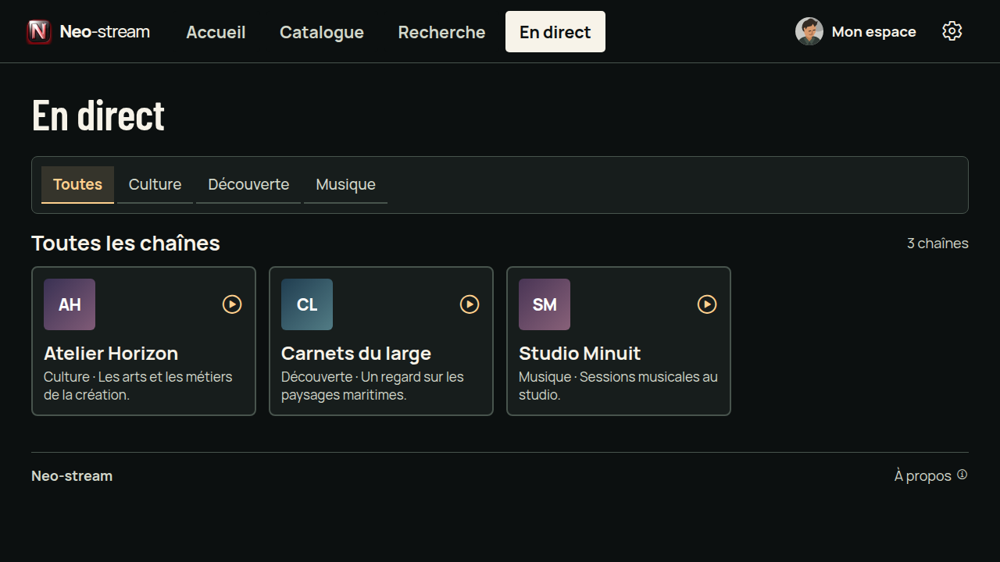

# Neo-stream

Parcourez les films et les séries sur votre téléphone, retrouvez une lecture en cours ou passez au direct sur Android TV. Sur le grand écran, l’interface se pilote à la télécommande.

**[Téléchargements Android ↓](../../releases)** · [Notes de la v1.0.0](docs/v1.0.0.md)

L’APK officiel sera proposé dans **Releases**, sous le nom `Neo-stream-Android.apk`. Si aucune version n’y apparaît, le téléchargement n’est pas encore ouvert.
<!-- Une fois l’APK officiel publié, le bouton peut pointer directement vers ../../releases/latest/download/Neo-stream-Android.apk. -->

### Installer sur Android

1. Sur votre téléphone, ouvrez **Téléchargements Android** puis sélectionnez `Neo-stream-Android.apk` dans les fichiers de la version. Pour une TV, transférez le même fichier sur le téléviseur et ouvrez-le depuis son gestionnaire de fichiers.
2. Si Android demande une autorisation, accordez-la uniquement à l’application qui ouvre l’APK. Vous pouvez la retirer après l’installation.
3. Pour vérifier le fichier, téléchargez aussi `SHA256SUMS.txt` depuis la même release. Dans le dossier contenant les deux fichiers, exécutez `sha256sum -c SHA256SUMS.txt` (Linux) ou `shasum -a 256 -c SHA256SUMS.txt` (macOS).

## L’application en images

| Se connecter sur téléphone | Ajuster les paramètres |
| :---: | :---: |
|  |  |



Captures réalisées sur l’interface web de l’application aux formats téléphone (412 × 860) et télévision (1280 × 720). Les chaînes visibles sont des exemples de démonstration.

## Modifier le client

Ce dépôt contient **le client d’origine** : écrans, navigation, lecteur, ressources embarquées et module Android. Il se compile sans configuration de production. En revanche, une compilation seule ne donne ni compte ni accès aux fonctionnalités connectées.

Avec **Node.js 24** et npm, depuis la racine :

```sh
npm ci --legacy-peer-deps
npm run web
```

L’option `--legacy-peer-deps` utilise le mode de résolution du fichier de verrouillage fourni. Ouvrez l’adresse locale indiquée par Expo. Les routes se trouvent dans `src/app/`, les écrans dans `screens/` et les composants de téléphone et de TV dans `components/`.

| Pour… | Commande |
| --- | --- |
| Vérifier le typage et le style | `npm run typecheck` puis `npm run lint` |
| Exporter la version web dans `dist/` | `npx expo export --platform web` |
| Compiler et lancer sur un appareil Android de développement | `npx expo run:android --device` |

Pour **construire un APK de développement** sans appareil connecté, installez un JDK 17 et le SDK Android 36, puis lancez :

```sh
npx expo prebuild --platform android --no-install
cd android
./gradlew :app:assembleDebug --max-workers=1
```

Sous Windows, utilisez `gradlew.bat`. L’APK généré se trouve dans `android/app/build/outputs/apk/debug/app-debug.apk`. Ce build utilise Metro pour développer ; ce n’est **pas** l’APK officiel signé des releases.

## Licence

Voir la [licence du code](LICENSE) et les notices des polices [Manrope](assets/fonts/OFL.txt) et [Barlow Condensed](assets/fonts/BarlowCondensed-OFL.txt). La licence du code n’accorde pas de droits sur les affiches, les portraits ni les marques de tiers.
